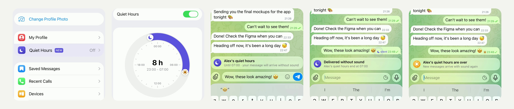

# Quiet Hours - the hours you rest, in your bio; messages then arrive without sound (iOS)

Set the hours you rest in **Settings → Quiet Hours**. Whoever writes to you in those hours from an app with Quiet Hours
sees it right above the message field, and what they send arrives without sound; a moon by the message shows it went
quietly. When your hours are over, the moon turns into a sun and messages come with sound again.

[](Media/quiet-hours.mp4)

▶︎ [Media/quiet-hours.mp4](Media/quiet-hours.mp4) - the feature in the iOS Simulator (2160×2160, 60 fps, 28 s, loops).

Pure UIKit and Telegram's own components (list sections, the switch, the glass button), no new dependencies, no
server changes: the hours are kept in the bio, and messages go out with Telegram's own silent flag. 54 files,
+3164 −40: two new modules, a new file in the chat controller, a new settings row, and hooks in existing files. Builds
with the project's own `Make.py build` (`debug_sim_arm64`).

## How it works

- **The settings row.** Under My Profile, a new **Quiet Hours** row with a night sky icon and the hours (or Off). The
  first three times it is seen it introduces itself: the row lights up in indigo and grows a little, the moon comes in,
  the title rises letter by letter and a NEW badge springs out with a sheen.
- **The screen.** A night sky, a line on what it does, and a switch. Turning it on brings in a 24-hour dial: an arc
  from a moon handle (when the hours start) to a sun handle (when they end), dragged in 15-minute steps, with how long
  they last in the middle ("8 h", "23:00 - 07:00"). The footer shows the tag that will be saved. Save reads the bio
  from the server first (so that nothing written on another device is lost), checks its length, and writes it back
  with the tag; it goes on even if the screen is left meanwhile.
- **In a chat.** In a private chat with someone whose quiet hours are on, a line rises above the message field as you
  start typing: "Alex's quiet hours · Until 07:00 · your message will arrive without sound". It grows as it comes in;
  its moon pops and turns, a ring goes out, the title and the text come in letter by letter, a sheen passes over.
  Messages sent then go out without sound, as with Send Without Sound: text, media, stickers, voice, results of inline
  bots. Scheduled messages are left alone.
- **The message.** A message that went quietly shows a moon and "silent" by its time. Just sent, the moon comes in
  large over the time, swings and settles, a ring closes in on it and three sparkles drift away, and the line says
  "Delivered without sound · Alex's quiet hours end at 07:00". When the hours are over the moon sets and a sun comes
  up in its place (for a day). If the hours end while the line is up, or after a message went quietly while the chat
  stayed open, the line says "Alex's quiet hours are over · New messages arrive with sound again" for a few seconds.
  Messages that reach you without sound in your own quiet hours show the same moon and sun.
- **Profiles.** The tag is hidden from the bio. A "quiet hours" row shows the hours instead, also on the reader's clock
  when their time zones differ, and "resting now" while they are on. Editing the bio (in the profile or in a voice
  chat) keeps the tag at its end.
- **Summer time.** The device remembers the tag and the time zone it belongs to: the tag it saved, or a tag set
  elsewhere that is on its own clock (the same offset from GMT) when it first sees it. After a change to or from summer
  time in that zone, the tag is written again with the same local hours and the new offset. A trip to another time
  zone, or a tag on another offset, is left alone.

## The tag

The hours are kept at the end of the bio, so that any Telegram app can read them:

```
Product designer at Northbridge 🌙 23:00-07:00 (GMT+1)
```

The times are on the owner's clock, whose offset from GMT the tag carries. This app reads the tag only at the very end
of a person's bio (not a bot's) and only if it is valid (quiet hours from 30 minutes to 23.5 hours); everything else
stays an ordinary bio. Apps without quiet hours show the tag as part of the bio, which reads well enough. Who can see
the hours is who can see the bio, as set in Privacy; the screen and the bio editor say so.

The silence is set by the sender's app: a message is sent with Telegram's own silent flag
(`NotificationInfoMessageAttribute(.muted)`), so it arrives without sound on all of the recipient's devices, whatever
app they use. Messages sent from apps without this change arrive with sound as usual.

## Repository

| Path | What |
|---|---|
| `submodules/` | The changed and new files, at their paths in Telegram-iOS (whole files of commit `279f89e4d4` with the change). |
| `Telegram/` | The English strings (`Localizable.strings`). |
| `quiet-hours.patch` | The same change as one patch. |
| `Media/quiet-hours.mp4` | Demo. |
| `Media/preview.jpg` | Stills from the demo. |

Where the code lives:

| File | What |
|---|---|
| `TelegramUI/Components/QuietHours/` | **New module.** The hours and the tag (`QuietHours.swift`), whose hours are known and the badge of a message (`QuietHoursDirectory.swift`), the moon, the sun and the sky (`QuietHoursGlyphs.swift`), the animations (`QuietHoursAnimations.swift`, `QuietHoursEffects.swift`), the line above the message field (`QuietHoursChatPanelComponent.swift`). |
| `TelegramUI/Components/QuietHoursScreen/` | **New module.** The screen and the safe save (`QuietHoursScreen.swift`), the dial (`QuietHoursDialView.swift`), summer time (`QuietHoursKeeper.swift`). |
| `TelegramUI/Sources/Chat/ChatControllerQuietHours.swift` | **New.** The chat: the person's hours and the account's own, what goes without sound, the line above the field, the timers. |
| `ChatController.swift`, `ChatControllerLoadDisplayNode.swift`, `ChatControllerMediaRecording.swift`, `ChatControllerForwardMessages.swift`, `UpdateChatPresentationInterfaceState.swift`, `ChatControllerNode.swift` | Messages sent from the chat go without sound (also inline results, recorded voice, forwards to several chats); the line above the field. |
| `ChatMessageDateAndStatusNode/` | The moon or the sun and "silent" by the time (`ChatMessageDateAndStatusQuietBadge.swift`); the text bubble plays the arrival, every other kind of message passes the badge. |
| `PeerInfoScreen/…` | The settings row (`ListItems/PeerInfoScreenQuietHoursItem.swift`), the hours on profiles, the bio edited without the tag. |
| `TelegramCallsUI/…` | The bio in voice chats, shown and edited without the tag. |
| `ApplicationContext.swift` | Starts keeping the account's quiet hours (summer time). |
| `ChatMessageItemView.swift` | VoiceOver says a message was delivered without sound. |
| `Localizable.strings`, `BUILD` files | Strings and the new dependencies. |

## Apply

Applies cleanly to [TelegramMessenger/Telegram-iOS](https://github.com/TelegramMessenger/Telegram-iOS) `master`
(`279f89e4d4f63f17227bf877dc3d8990f22ecd58`):

```sh
git apply quiet-hours.patch
```

or, on that commit only, copy `submodules/` and `Telegram/` over the repository (they are whole files: on a newer
`master` use the patch). Then build as described in the Telegram-iOS README.

## Notes and limits

- The conversation in the video is staged for the demo: two fictional people (Alex Astero and Maya, their names,
  photo, number, username, bio and messages) stored on the simulator, and nothing was sent to a server. The clock is
  set by the recording setup (22:47, then 23:48, then the status bar runs through the night to 07:00), and Maya's
  typing is written into the field by it. Those are part of the recording setup only, not of the patch; everything
  else is the app running this code.
- A person's hours are known once the app has read their bio in their chat (opened since the app started).
  Forwarding to several chats at once goes without sound only to people already known; sending from outside the app
  (the share extension, a reply from a notification) is not silenced.
- The moon and the sun follow the person's current hours: if they change their hours, older messages follow.
- The screen shows and sets the hours on the device's clock; whether someone is resting is worked out on the server's
  time, as the times of messages are.
- Only English strings are added; other languages fall back to them.
- Checked in the simulator: the settings row and its introduction, the screen, the dial, saving, the line above the
  field, sending, the moon arriving, the morning; a clean build of the patch. Not checked: two real accounts talking
  to each other, on a device, in a release build.

## License

An unofficial change to [Telegram-iOS](https://github.com/TelegramMessenger/Telegram-iOS), not affiliated with Telegram,
published openly so that it can be used under the terms of the original project.
